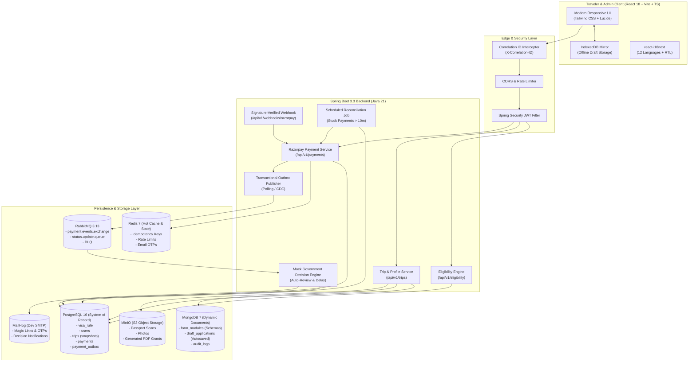

# VisaSetu (वीजासेतु) — Unified Multilingual e-Visa Platform

> **Disclaimer:** Concept project — not affiliated with the Government of India. Sample data — verify with official source.

VisaSetu is a modern, enterprise-grade, streamlined travel authorization platform designed to solve the five fundamental frustrations of modern international travelers visiting India.

---

## The 5 Core Problems & How VisaSetu Solves Them

| # | The Problem | How VisaSetu Solves It | Technical Implementation |
|---|---|---|---|
| **1** | **Crash loses form data; money debited but application not marked paid** | **Dual-Store Autosave & Resilient Payments**<br/>Every keystroke is saved locally in IndexedDB and debounced (1.5s) to MongoDB drafts with optimistic locking. Resume on any device via email OTP. Server computes payment fees; signature-verified webhooks are the sole source of truth; unique constraints prevent double charges; automated reconciliation job heals payments pending >10 min. | **Section C & D**<br/>• Frontend: IndexedDB + offline retry queue<br/>• Backend: MongoDB drafts (`version` field) + PostgreSQL SoR<br/>• Payments: Razorpay HMAC verification, Redis idempotency keys, `@Scheduled` reconciliation job, Transactional Outbox + RabbitMQ |
| **2** | **Cluttered UI with 3–4 long, intimidating forms** | **Modern 5-Step Unified Wizard**<br/>Replaces legacy multi-page forms with a clean, mobile-first wizard: maximum 5 steps, ≤7 fields per screen, plain-language labels, inline validation, and dynamic "~N min left" progress estimation. WCAG 2.2 AA accessible. | **Section B**<br/>• React + Vite + TypeScript<br/>• Tailwind CSS + Lucide icons<br/>• React Hook Form + Zod schema validation<br/>• Step-by-step progress calculation |
| **3** | **Three portals, same details entered 3 times (e-Visa, Arrival Card, Suvidha)** | **Unified "Trip" Profile Auto-Fill**<br/>The traveler enters their passport and trip profile once. Pluggable `FormModule` definitions in MongoDB map shared fields into e-Visa, e-Arrival Card, and e-Suvidha health clearance simultaneously under one unified reference ID. | **Section B**<br/>• Pluggable FormModule engine in MongoDB<br/>• Shared profile normalization<br/>• One Reference ID (`VS-2026-XXXX`)<br/>• Single combined payment & consolidated QR passes |
| **4** | **Traveler can't see real options or processing time (e.g., Japan VoA)** | **Smart Eligibility & Route Comparison Engine**<br/>Entering nationality and trip purpose instantly displays *every* applicable official route from the DB: Visa-Free, e-Visa, Visa on Arrival (VoA), and Embassy Visa. Includes live fee, typical and maximum processing times, validity, stay limits, allowed entry ports, and document checklists. | **Section A**<br/>• Table `visa_rule` with dynamic port and doc arrays<br/>• REST API `GET /api/v1/eligibility`<br/>• Automatic apply-by deadline calculation<br/>• Official source URLs & "Sample data" disclaimers<br/>• Fallback to embassy consultation when no rule exists |
| **5** | **English-only interface** | **12 Languages with RTL & Logical CSS**<br/>Full internationalization supporting 12 languages: English (`en`), Hindi (`hi`), Japanese (`ja`), Korean (`ko`), Simplified Chinese (`zh-CN`), French (`fr`), German (`de`), Spanish (`es`), Russian (`ru`), Arabic (`ar` with RTL), Brazilian Portuguese (`pt-BR`), and Italian (`it`). | **Section E**<br/>• `react-i18next` with lazy-loaded namespaces<br/>• RTL layout via CSS logical properties<br/>• Noto font stack for CJK, Arabic, and Devanagari<br/>• CI script that enforces key parity across all locales |

---

## Architecture Overview



---

## Quickstart & Run Guide

### 1. Prerequisites
- **Docker** and **Docker Compose**
- **Java 21+** and **Maven 3.9+** (optional for local non-container development)
- **Node.js 22+** and **npm 10+** (optional for local non-container development)

### 2. One-Command Setup with Docker Compose
Clone the repository and run all services:

```bash
# Clone and enter workspace
git clone <repository-url>
cd E-VISA

# Copy environment template
cp .env.example .env

# Spin up all infrastructure and applications
docker compose up -d
```

### 3. Service Endpoints
- **Frontend Application**: [http://localhost:5173](http://localhost:5173)
- **Backend REST API**: [http://localhost:8080](http://localhost:8080)
- **API Health & Actuator**: [http://localhost:8080/actuator/health](http://localhost:8080/actuator/health)
- **RabbitMQ Management Dashboard**: [http://localhost:15672](http://localhost:15672) (User: `visasetu_rabbit` / Pass: `visasetu_rabbit_dev_pass`)
- **MinIO Console**: [http://localhost:9001](http://localhost:9001) (User: `minioadmin` / Pass: `minioadmin`)
- **MailHog Web Inbox**: [http://localhost:8025](http://localhost:8025)

---

## Local Development & Testing

### Backend
```bash
cd backend

# Run all unit and integration tests
mvn test

# Run Spring Boot backend locally
mvn spring-boot:run
```

### Frontend
```bash
cd frontend

# Install dependencies
npm install

# Typecheck and run tests
npm run typecheck
npm run test

# Run Vite dev server
npm run dev
```

---

## Acceptance Verification: Smart Eligibility Checker (Phase 1)
1. Navigate to [http://localhost:5173](http://localhost:5173) (or run frontend tests with `npm run test`).
2. Select **Japan (JPN)** and **Tourism & Recreation (`TOURISM`)**.
3. Observe all applicable routes dynamically populated from PostgreSQL:
   - **Visa on Arrival (VoA)**: Fee $25 USD, 0–1 days processing (at port), 60 days validity, double entry, allowed ports (Delhi, Mumbai, Kolkata, Chennai, Bengaluru, Hyderabad).
   - **e-Tourist Visa (30 Days)**: Fee $25 USD, 3–4 days processing, recommended badge.
   - **e-Tourist Visa (1 Year)**: Fee $40 USD, 3–4 days processing, 365 days validity.
   - **Regular Embassy Visa**: Fee $40 USD, 7–10 days processing.
4. If arrival date is supplied (e.g. 20 days in future), the engine automatically computes the recommended apply-by deadline date based on `processingDaysMax`.
5. Testing an unsupported nationality (e.g. `XYZ`) smoothly displays the official Embassy Consultation fallback.

---

## Architectural Decision Records (ADRs)
- [ADR-001: Transactional Outbox Pattern for Payment & State Events](file:///Users/mahesh/Downloads/E-VISA/docs/adr/ADR-001-transactional-outbox.md)
- [ADR-002: Dual-Store Strategy (PostgreSQL & MongoDB)](file:///Users/mahesh/Downloads/E-VISA/docs/adr/ADR-002-dual-store-strategy.md)
- [ADR-003: Idempotent Payment Webhooks & Automated Reconciliation](file:///Users/mahesh/Downloads/E-VISA/docs/adr/ADR-003-idempotent-payments-and-reconciliation.md)

---

## Quality & Security Bar
- **PII Protection**: Column-level encryption for passport numbers and birth dates.
- **Traceability**: `X-Correlation-ID` header injected on every request and propagated across backend logs.
- **Auditing**: All data access is audited with timestamps and actor IDs.
- **Zero Secrets in Code**: All sensitive credentials managed via environment variables and secret stores.
