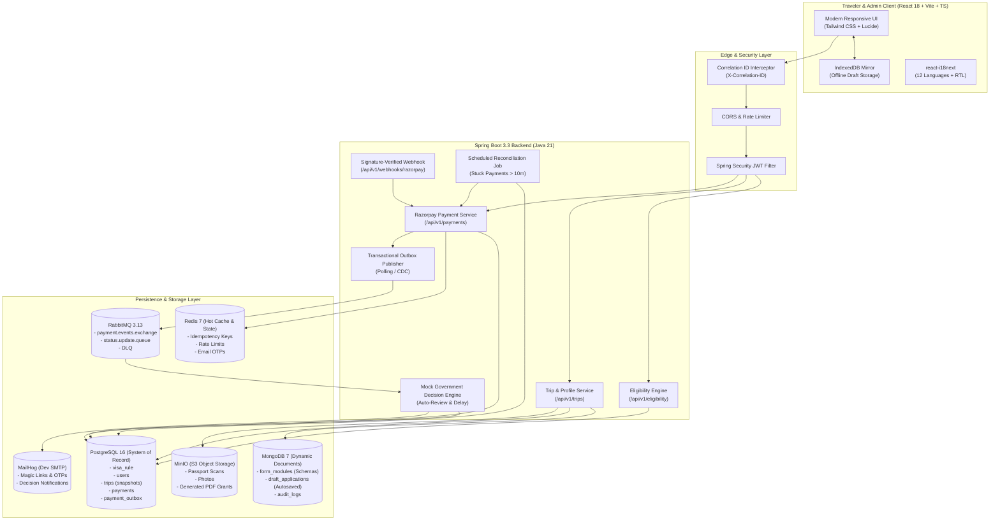

# VisaSetu System Architecture

## Architecture Diagram

## Architectural Tenets
1. **Separation of System of Record & Working Drafts**:
   - PostgreSQL holds submitted, immutable financial, trip, and rule data.
   - MongoDB holds dynamic JSON schema-driven module forms and fast autosaves.
2. **Never Lose Data**:
   - IndexedDB in the browser acts as a local sync buffer.
   - Drafts are continuously debounced (1.5s) to MongoDB with versioned optimistic locking.
3. **Financial State Correctness**:
   - Webhook is the single source of truth for payment success.
   - Idempotency keys stored in Redis prevent duplicate charges.
   - Transactional outbox ensures eventual consistency between payment ledger and notification/review queues.
   - Automated reconciliation self-heals stranded pending payments.
